# IoTShield AI
### AI-Powered Ransomware Detection and Prevention Simulator for IoT and Industrial IoT (IIoT) Networks

[](https://www.python.org/)
[](https://streamlit.io/)
[](https://scikit-learn.org/)
[](https://docs.pytest.org/)
[](#ui-and-visual-identity)
[](https://qau.edu.pk/)

> **IMPORTANT ETHICS & SAFETY NOTICE:**
> **SAFE SIMULATION ONLY — NO REAL RANSOMWARE OR MALWARE IS EXECUTED.**
> This project runs strictly in an isolated simulation environment on local loopback/memory. All telemetry is synthetically generated; file alterations occur only on mock `.demo` text files within a sandboxed `demo_sandbox/` directory. Network quarantine is virtual (in-memory socket containment) and **never** modifies host networking, routing tables, or Windows Defender/Firewall settings.

---

## Executive Overview

**IoTShield AI** is an advanced cybersecurity research prototype and educational demonstration system developed for the **Information Security** course at **Quaid-i-Azam University (QAU), Islamabad**. 

The platform demonstrates how machine learning classifiers paired with policy-driven autonomous response agents can reliably detect and contain ransomware-like anomalous behaviors in resource-constrained Internet of Things (IoT) and Industrial IoT (IIoT) environments before critical operational infrastructure is compromised.

---

## Key System Capabilities

- **Heterogeneous IoT/IIoT Fleet Simulation**: Emulates telemetry, file activity, and outbound communication patterns across four distinct device profiles:
  - `CAM-01`: IoT Smart Surveillance Camera (high network throughput, continuous streaming).
  - `TEMP-01`: IoT Industrial Temperature Sensor (periodic telemetry, low compute profile).
  - `PLC-01`: IIoT Programmable Logic Controller (mission-critical industrial control, sensitive filesystem).
  - `GW-01`: IIoT Field Edge Gateway (multi-protocol aggregation, external telemetry routing).
- **Machine Learning Detection Engine**: High-precision **Random Forest Classifier** trained on synthetic behavioural windows (CPU/RAM usage, file modification rates, entropy changes, connection burst spikes, and failed authentication attempts).
- **Rolling Multi-Window Risk Policy**: Incorporates device criticality weightings and enforces a consecutive two-window verification threshold to eliminate transient false alarms while maintaining near-zero detection latency during high-severity attacks.
- **Autonomous & Human-in-the-Loop Quarantine**:
  - Enforces explicit analyst verification for high-criticality assets (`PLC-01`, `GW-01`) via interactive dashboard modals.
  - Supports configurable simulation-only automated containment for rapid zero-touch scenarios (`SIMULATED_APPROVAL`).
- **Complete One-Click Security Demonstration**: A state-machine-driven demonstration workflow (`Stage 1: Normal` $\rightarrow$ `Stage 2: Attack Launch` $\rightarrow$ `Stage 3: AI Detection` $\rightarrow$ `Stage 4: Quarantine Approval` $\rightarrow$ `Stage 5: Prevention Verification`) executable via a single primary action with confirmation safeguards.
- **Dedicated Forensic Security Report Export**: Built-in instant export of comprehensive Markdown security audit reports containing complete incident timeline, 23 state attributes, forensic telemetry snapshots, and blocked simulated event tallies.
- **Modern Porcelain Plum UI/UX**: Professional, accessible, light-first cybersecurity dashboard built in Streamlit featuring responsive CSS layouts, unified brand navigation, asymmetric posture cards, and real-time Plotly charts.

---

## Architectural Workflow

```mermaid
flowchart LR
    subgraph Fleet["IoT / IIoT Virtual Fleet"]
        CAM["CAM-01\n(Camera)"]
        TEMP["TEMP-01\n(Sensor)"]
        PLC["PLC-01\n(PLC)"]
        GW["GW-01\n(Gateway)"]
    end

    subgraph Sim["Sandbox & Simulator Engine"]
        Normal["Normal Telemetry Engine"]
        Attack["Safe Attack Simulator\n(demo_sandbox/)"]
    end

    subgraph AI["Detection & Policy Controller"]
        Feat["Feature Extractor\n(15 Behavioral Metrics)"]
        RF["Random Forest Classifier\n(NORMAL vs RANSOMWARE_LIKE)"]
        Policy["Risk Policy Engine\n(Criticality + Multi-Window)"]
    end

    subgraph Prevention["Containment & Reporting"]
        Quarantine["Virtual Network Quarantine\n(Simulated Port Blocking)"]
        Audit["Forensic Event Log\n(logs/security_events.jsonl)"]
        Report["Markdown Security Report\n(Instant Export)"]
    end

    Fleet --> Sim
    Sim --> Feat
    Feat --> RF
    RF --> Policy
    Policy -- "Approval Trigger" --> Quarantine
    Policy --> Audit
    Quarantine --> Report
```



---

## Project Structure

```
IoTShield_AI/
├── app.py                     # Main interactive Streamlit application & navigation hub
├── train_model.py             # Synthetic data generator & Random Forest training pipeline
├── demo_scenario.py           # Headless CLI end-to-end demonstration script
├── start_demo.bat             # 1-Click Windows execution script
├── requirements.txt           # Python dependency specifications
├── README.md                  # Comprehensive documentation and project guide
├── .gitignore                 # Exclusion configuration for caches, media, and zip files
│
├── src/                       # Core simulation, ML, and defense modules
│   ├── agent_controller.py    # Autonomous risk assessment & decision engine
│   ├── data_generator.py      # Reproducible synthetic IoT/IIoT telemetry generator
│   ├── detector.py            # Model inference, thresholding & explainability
│   ├── device_simulator.py    # Virtual hardware profile abstractions
│   ├── feature_engineering.py # Behavioral window calculation & feature pipeline
│   ├── report_generator.py    # Forensic security Markdown report builder
│   ├── safe_attack_simulator.py # Isolated sandboxed file activity simulator
│   ├── session.py             # Authoritative state machine & demonstration manager
│   ├── ui_theme.py            # Porcelain Plum design tokens, CSS & component renderers
│   └── virtual_network.py     # In-memory virtual firewall & quarantine controller
│
├── data/                      # Training, validation & test datasets
│   ├── generated/             # Generated synthetic datasets (train, val, test, full)
│   └── sample/                # Sample reference telemetry windows
│
├── models/                    # Serialized machine learning assets
│   ├── baseline_stats.json    # Normal telemetry distribution baselines
│   ├── feature_order.json     # Feature schema specification
│   └── ransomware_rf.joblib   # Trained Scikit-Learn Random Forest model
│
├── demo_sandbox/              # Isolated dummy directory for safe file manipulation
│   ├── CAM-01/                # Dummy .demo files for Camera
│   ├── GW-01/                 # Dummy .demo files for Gateway
│   ├── PLC-01/                # Dummy .demo files for PLC (default target)
│   └── TEMP-01/               # Dummy .demo files for Sensor
│
├── evidence/                  # Generated audit evidence, metrics & screenshots
│   ├── demo_results/          # Artifacts from headless CLI demonstration runs
│   ├── evaluation/            # Confusion matrices, ROC curves, feature importances
│   ├── screenshots/           # UI Chrome verification captures (all viewports)
│   └── test_results/          # Pytest automated test logs
│
├── scripts/                   # Verification & automated test scripts
│   ├── capture_screenshots.py # Multi-resolution headless screenshot capture
│   ├── verify_download_and_run_all.py # End-to-end UX verification script
│   └── verify_header.py       # CDP-based top header layout test script
│
├── logs/                      # Audit trails
│   └── security_events.jsonl  # Append-only structured JSONL security event log
│
└── tests/                     # Automated testing suite
    ├── conftest.py            # Shared pytest fixtures & test environment setup
    ├── test_agent.py          # Decision engine & quarantine policy tests
    ├── test_app.py            # Streamlit UI integration & navigation tests
    ├── test_detector.py       # Machine learning inference & validation tests
    ├── test_download_and_run_all.py # Report generation & demo runner tests
    ├── test_sandbox.py        # Path traversal & sandbox boundary tests
    └── test_simulator.py      # Device telemetry & virtual network tests
```

---

## Installation & Setup

### Prerequisites
- **Operating System**: Windows 10/11, macOS, or Linux.
- **Python Version**: Python 3.10 to 3.13 (Python 3.13 recommended).
- **Hardware Requirements**: Any standard PC or laptop; GPU acceleration is **not** required.

### 1. Clone the Repository
```bash
git clone https://github.com/Calipha-Rayyan/IotShield-AI.git
cd IotShield-AI
```

### 2. Set Up Virtual Environment
On Windows (PowerShell):
```powershell
python -m venv .venv
.\.venv\Scripts\Activate.ps1
```
*(If PowerShell restricts script execution, run: `Set-ExecutionPolicy -Scope Process -ExecutionPolicy Bypass`)*

On macOS / Linux:
```bash
python3 -m venv .venv
source .venv/bin/activate
```

### 3. Install Dependencies
```bash
pip install -r requirements.txt
```

### 4. Train the Detection Model (Optional / Pre-trained Included)
A pre-trained model is already included in `models/`. To retrain from scratch:
```bash
python train_model.py
```
*Generates synthetic datasets, trains the Random Forest classifier, exports evaluation metrics, and writes to `models/`.*

---

## Running the Application

### Method A: One-Click Quick Launch (Windows)
Double-click `start_demo.bat` in the project root. It automatically initializes the environment and launches the dashboard.

### Method B: Streamlit Web Dashboard
With your virtual environment active, run:
```bash
streamlit run app.py
```
Open your browser at **`http://localhost:8501`**.

#### Running the Demonstration via Web UI:
1. **One-Click Execution**: On the **Overview** page, click the prominent **`Run All Operations`** button inside the *Complete Security Demonstration* panel. Confirm the modal to run all 5 demonstration stages automatically.
2. **Step-by-Step Guided Mode**: Use the sequential buttons (`1. Start Normal Simulation`, `2. Launch Safe Ransomware Simulation`, `3. Run AI Detection`, `4. Approve Quarantine`, `5. Advance Simulation`) to observe state transitions individually.
3. **Download Incident Report**: Click the **`Download Report`** button in the top unified header at any point to obtain a Markdown audit log of the active scenario.
4. **Inspect Detailed Views**: Use the left navigation rail to access:
   - **Devices**: Real-time virtual device metrics and operational health.
   - **Network Traffic**: Live Plotly bandwidth, packet transmission, and connection rate graphs.
   - **AI Detection**: Feature contribution breakdowns, prediction probabilities, and risk score drivers.
   - **Prevention Center**: Virtual quarantine controls, active blocked socket events, and containment status.
   - **Security Events**: Structured audit table of all logged security operations.
   - **Model Evaluation**: Confusion matrix, classification report, and synthetic training metrics.

### Method C: Headless CLI Demonstration
To run a complete demonstration without opening a web browser:
```bash
python demo_scenario.py
```
*Executes all five demonstration stages in the terminal, verifies quarantine and packet blocking, and outputs forensic summaries to `evidence/demo_results/`.*

---

## Automated Testing Suite

The project includes an automated test suite verifying machine learning inference, sandbox safety, policy engines, and Streamlit UI components:

```bash
pytest -v
```

### Test Coverage Highlights:
- **Sandbox Boundary Verification (`test_sandbox.py`)**: Asserts that file operations strictly reject path traversals (`../../`), absolute path escapes, and directory boundary violations.
- **Model Inference (`test_detector.py`)**: Validates prediction consistency, probability calibrators, and feature alignment.
- **Agent Policy & Quarantine (`test_agent.py`)**: Verifies multi-window thresholds, criticality weightings, and state reversibility.
- **UI & Demonstration Workflows (`test_app.py`, `test_download_and_run_all.py`)**: Tests navigation state, dialog handlers, full demonstration runs, and Markdown report generation.

---

## Academic Context & Limitations

This system is an academic research demonstration for university coursework in **Information Security**:
- **Synthetic Data**: Machine learning models were trained on simulated behavior profiles engineered to represent IoT/IIoT attack mechanics. Results reflect synthetic scenario parameters and are not calibrated for unmanaged production network traffic.
- **Non-Destructive Simulation**: Sandboxed encryption renames dummy files with `.locked_demo` extensions and writes mock ransom notes. It does not perform cryptographic cipher operations or touch system directories.
- **Virtual Firewall**: Network isolation is tracked logically in memory; it demonstrates the containment concept without modifying physical network interfaces.

---

## License & Authorship

Developed for the **Department of Computer Science**, **Quaid-i-Azam University (QAU), Islamabad**.

For educational, research, and cybersecurity simulation purposes only.
